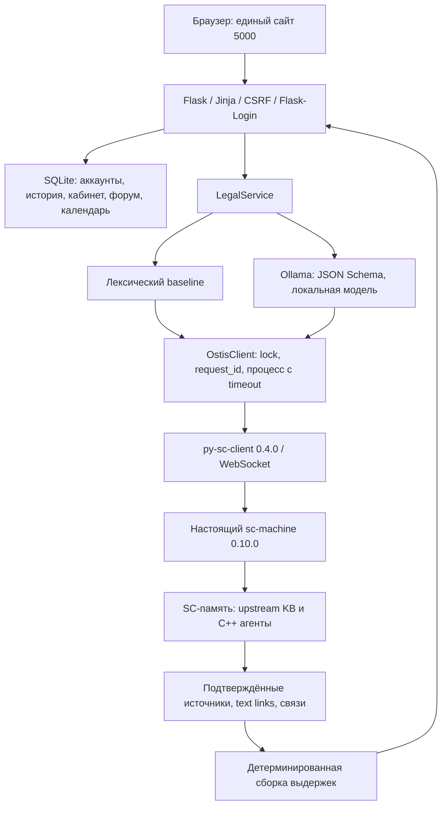

# Архитектура

Новая прикладная логика написана на Python. sc-machine остаётся C++ службой.
Контейнер machine собирает все upstream-расширения; ни один старый агент не удалён.
После TLS-сбоя Conan-сервера сборка переведена на официальный CPack SDK 0.10.0
с GitHub Releases и find_package(sc-machine) через CMAKE_PREFIX_PATH.
Собственный ostis/Dockerfile не изменяет checkout upstream; перед финализацией образа
проверяются динамические библиотеки и наличие всех 14 групп агентов.
Собственное Python-приложение заменяет пользовательские транзакционные функции,
не мигрируя и не очищая существующие SC-аккаунты/историю. Автоматического импорта чужих личных данных нет.

SDK 0.4.0 имеет глобальную сессию без deadline чтения. Каждый вызов выполняется отдельным
Python worker-процессом, stdout содержит один JSON с request_id, логирование идёт в stderr.
Фронтовый процесс сериализует SDK-вызовы lock-ом; ожидание свободного слота ограничено 1 секундой.
Полный subprocess timeout ограничивает зависший SDK. Сокет закрывается в finally;
при превышении deadline worker завершается. Переподключение с повтором записи отключено.

`action_user_request` создаёт новый action/input link, rrel_1, членство action/action_user_request,
потом action_initiated. Завершение опрашивается по action_finished_*; подписки не создаются,
поэтому глобальные callbacks не могут смешаться. Успешная структура читается через nrel_result.
При пустом/неуспешном результате читается SC-шаблон. Метод виден в trace. При timeout
результат считается неизвестным, автоматического повторного действия нет.
Созданные действия остаются в SC-памяти; их безопасная архивная очистка пока не реализована.

Поиск не открывает статический JSON и не читает юридические данные из SQLite.
`docs/evidence/upstream.json` и `data/evaluation` служат только аудиту/оценке; runtime к ним не обращается.
Термин связывается с nrel_main_idtf + lang_ru + belarus_legal_term. Определения читаются
через rrel_key_sc_element / nrel_sc_text_translation / rrel_example; HTML превращается в обычный текст.
Связи singular/plural учитываются раздельно. SC-ID читается через nrel_system_identifier,
а числовой адрес явно отделён от системного идентификатора. Никакого создания ключевых узлов при поиске нет.

Перед LLM-запросом worker читает названия реальных членов belarus_legal_term через
nrel_main_idtf/lang_ru. Они передаются локальной модели как available_terms и enum
для search_terms в JSON Schema. После генерации Python повторно проверяет членство
терминов в текущем словаре, затем связывает их с SC-объектами обычным gateway.
Статический список из аудита/датасета для этого не используется; SQLite не участвует.
Пустой словарь/ошибка OSTIS блокирует LLM-ветку. Baseline словарь для LLM не запрашивает.
Ollama получает запрос, названия понятий текущей KB и строгую схему. Содержимое модели никогда не
используется как текст закона. Схема ограничивает поля/размеры/типы, unknown fields запрещены,
неподтверждённые факты не идут в поиск. На ошибку JSON допускается один повтор. URL внешней модели
и cloud-tag запрещены; httpx не использует proxy из окружения для запросов к локальным службам.

SQLite: foreign_keys=ON, busy_timeout, три явные Alembic-миграции, FK и уникальные ограничения.
Пароли scrypt, одноразовые случайные токены хешированы, сессия содержит версию авторизации.
Сброс пароля меняет версию и отзывает старые сессии. У каждой приватной операции — контроль владельца.
Все браузерные/JSON mutations требуют CSRF. Поля Jinja экранируются, политика CSP запрещает inline scripts.
Ограничитель частоты действует в одном процессе Waitress, внешний доступ привязан к loopback.

Рекомендации форума независимы от юридического поиска. Лексическая близость текста,
тематические метки и просмотры текущего пользователя ранжируют реальные темы форума.
Отзывы хранятся на пользователя и контекст; негативный отзыв не влияет на чужие выдачи.
Это эвристика навигации по обсуждениям, не семантический юридический вывод и не внешняя модель.

Тома: kb-binary, app-data, ollama-models. source mount KB read-only; абсолютный storage=/kb.bin
устраняет неопределённость относительного пути upstream config. sc-web — отдельный debug-профиль.
Статусы готовности не утверждают актуальность нормативных данных. Живая схема остаётся NOT TESTED,
пока Docker и SC-память не пройдут gates S1–S3/S7.
